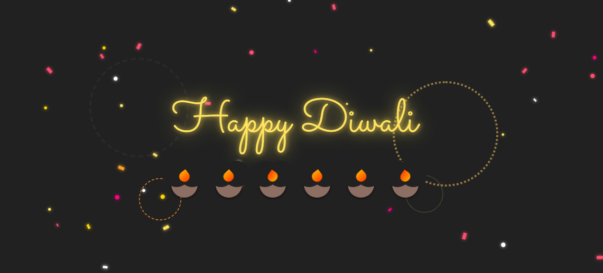

# 🪔 Happy Diwali

## 📌 Overview
***Happy Diwali Greeting Card*** is a festive, interactive web animation created for **Tech and Fun Zone**. This project showcases custom CSS keyframe animations, glowing typography using Google Fonts, cute animated CSS Diyas, pulsing starburst fireworks, and a dynamic HTML5 JavaScript confetti falling effect.

---

## ✨ Features

- **Animated Typography -** Custom glowing font effects using Google Font `Sacramento` with smooth CSS entrance animations.
- **Cute CSS Diyas -** Handcrafted traditional clay diyas created purely using CSS pseudo-elements (`::before`, `::after`) with dynamic flickering flames.
- **Ambient Firecracker Bursts -** Glowing starburst animation rings bursting around the main greeting banner.
- **Dynamic Falling Confetti -** HTML5 Canvas particle system generating continuous gold, magenta, and orange falling confetti.
- **Centered Responsive Layout -** Clean flexbox alignment that adjusts smoothly on desktop and mobile screens.

---

## 🖼️ Preview
<p align="center">
  
</p>

---

## 🚀 Getting Started
1. Clone or download this repository.
2. Open `index.html` directly in any web browser to view the interactive animation.

---

## 📂 Project Structure

```text
Happy-Diwali-Animation/
│
├── Images/           # Contains screenshot assets (Output.PNG)
├── index.html        # Main HTML file with CSS styling and Canvas JS script
└── README.md         # Project documentation
```

---

## 🛠 Tech Stack
<div style="display: flex; flex-wrap: wrap; gap: 8px;">


</div>

---

## 📌 Future Enhancements
- **Festive Background Music -** Add an interactive toggle button for background festive music/firecracker sound effects using the Web Audio API.
- **Interactive Light Up -** Allow users to click individual Diyas to light them up or blow them out.
- **Custom Name Generator -** Add an input box where visitors can enter their own name to generate personalized Diwali wish links.